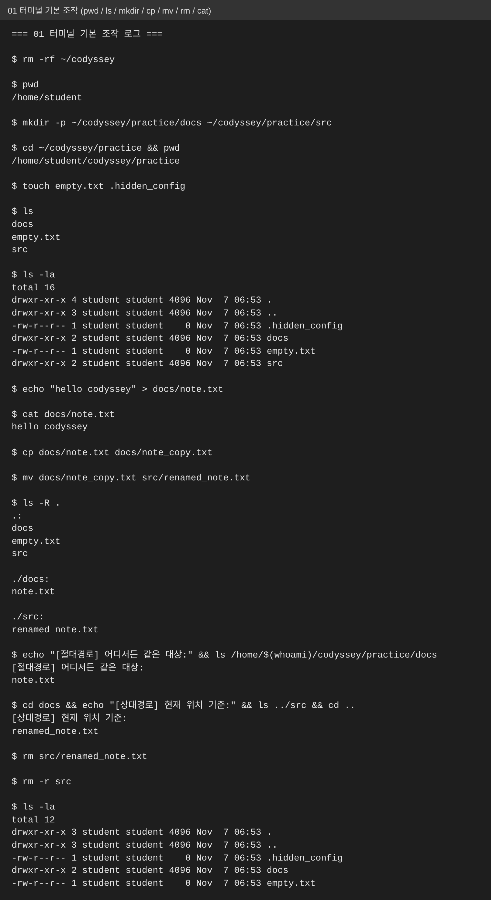
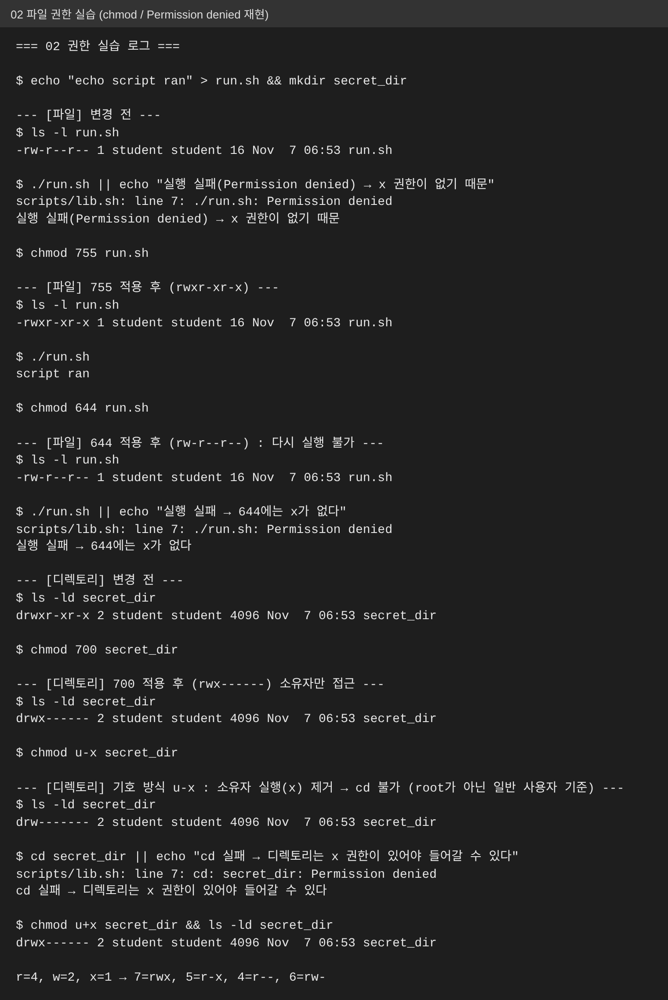
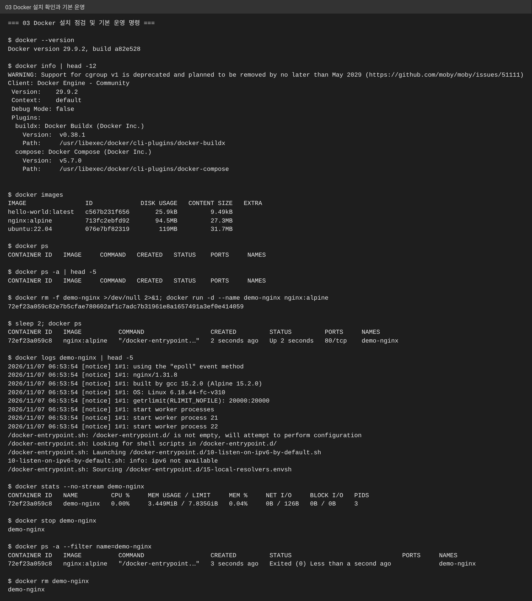
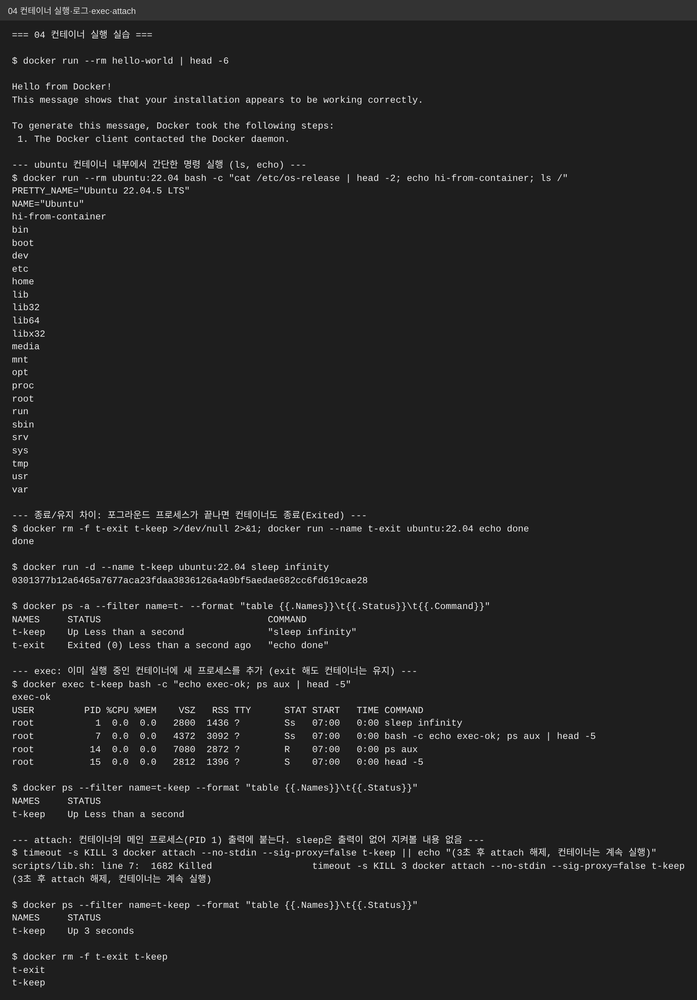
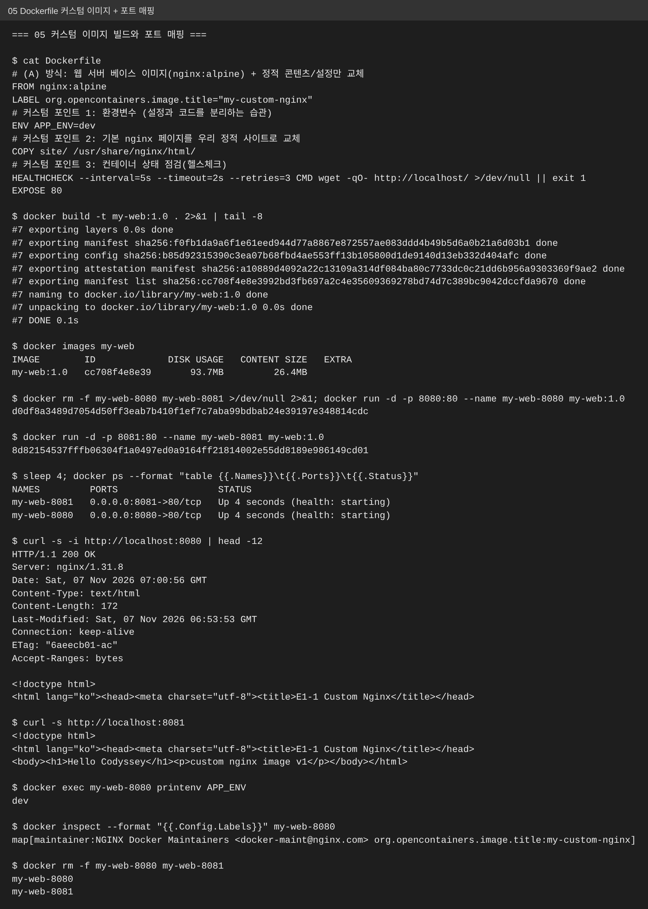
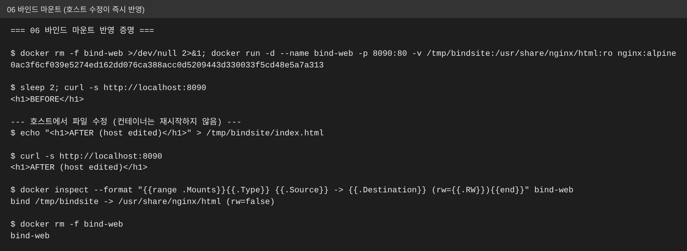
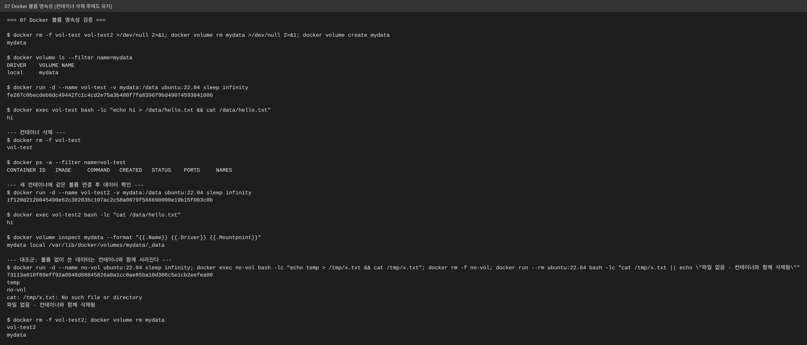
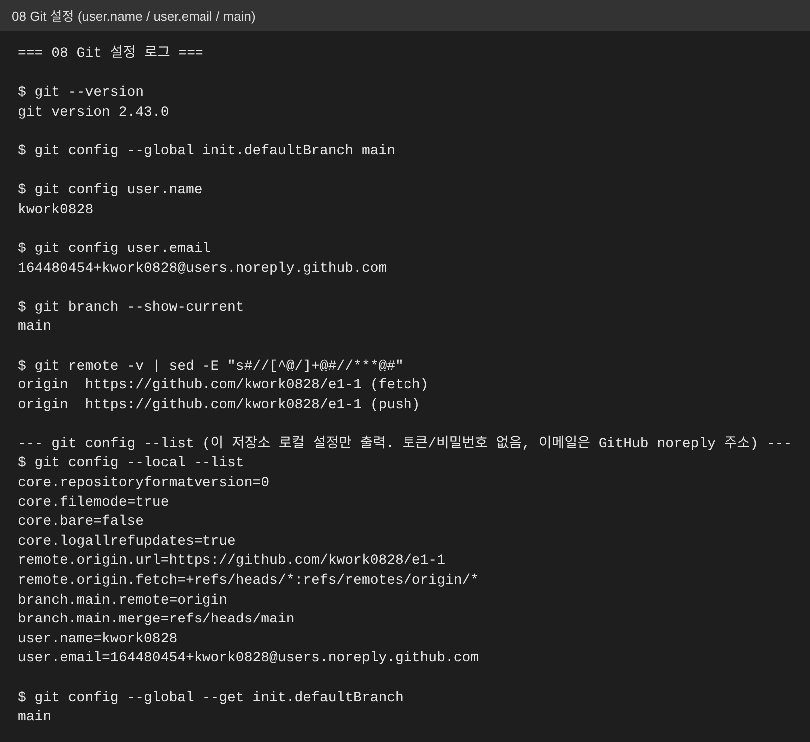

# E1-1 · 내 컴퓨터에 개발자용 '작업실' 꾸미기

> 터미널(CLI) · Docker · Git 세 가지를 **직접 실행**하고, 명령어와 출력 결과를 그대로 남긴 기술 문서입니다.
> 이 문서만 읽어도 무엇을 했고, 왜 그렇게 했고, 어떻게 확인했는지 따라올 수 있도록 순서대로 구성했습니다.

## 0. 먼저 읽을 것: 이 기록의 실행 환경과 한계 (정직 공지)

| 항목 | 내용 |
|---|---|
| 실행 위치 | Linux 클라우드 컨테이너(Claude Code 세션). **교육용 PC(OrbStack)가 아님** |
| 그래서 동일한 것 | `docker` 명령어와 동작은 OrbStack과 동일 (OrbStack도 내부적으로 Docker 엔진 사용) |
| 그래서 다른 것 | 브라우저 주소창 캡처 불가 → **`curl -i` 응답(주소 + 포트 + 응답 본문)으로 대체** |
| PC에서 직접 해야 하는 것 | VSCode GitHub 로그인 연동 캡처 (8장 체크리스트 참고, 가짜로 만들지 않음) |
| 재현성 | 모든 로그는 `scripts/NN_*.sh`를 실행하면 `docs/logs/`에 다시 생성됨 |

## 1. 프로젝트 개요 (미션 목표 요약)

개발은 코드를 쓰는 순간이 아니라 **환경을 세팅하는 순간**부터 시작됩니다. 이 미션에서는

1. 터미널로 작업 디렉토리와 권한을 다루고
2. Docker를 점검하고 컨테이너를 실행/관리하며
3. Dockerfile로 웹 서버를 컨테이너화해 **포트 매핑**으로 접속하고
4. **바인드 마운트(변경 반영)** 와 **볼륨(데이터 영속성)** 을 직접 검증하고
5. Git/GitHub 설정을 마칩니다.

핵심 질문은 "왜 이런 설계가 필요한가"입니다. 각 장 끝에 한 줄 설명을 붙였습니다.

### 1-1. 핵심 개념 정리 (동료 교육생용 한눈에 보기)

| 개념 | 일상 비유 | 한 줄 정의 | 대표 명령 | 증거(장) |
|---|---|---|---|---|
| 절대 / 상대 경로 | 전체 도로명 주소 vs "저기서 두 번째 집" | 절대는 `/`부터 시작해 어디서나 같은 대상, 상대는 현재 위치 기준 | `pwd`, `cd ../src` | 4장 |
| 파일 권한 (755 / 644) | 방문 허가증 (열람 · 수정 · 출입) | r=4, w=2, x=1을 소유자/그룹/기타별로 더한 숫자 | `chmod 755 run.sh`, `ls -l` | 5장 |
| 이미지 vs 컨테이너 | 붕어빵 틀 vs 붕어빵 | 이미지는 읽기 전용 설계도, 컨테이너는 그 설계도로 띄운 실행 중인 인스턴스 | `docker images`, `docker ps` | 6~7장 |
| Dockerfile | 요리 레시피 | `FROM` 베이스 위에 `COPY/ENV/LABEL/HEALTHCHECK`를 얹어 이미지를 만드는 설명서 | `docker build -t ... .` | 8장 |
| 포트 매핑 | 건물 대표번호 → 내선번호 | 격리된 컨테이너 포트와 내 컴퓨터 포트를 연결 (`호스트:컨테이너`) | `docker run -p 8080:80` | 8장 |
| 바인드 마운트 | 내 책상을 창문으로 비춰 보기 | 호스트 폴더를 컨테이너에 그대로 연결해 호스트에서 고치면 **즉시 반영** | `-v 호스트경로:컨테이너경로` | 9장 |
| 볼륨 | 이사해도 따로 보관하는 창고 | Docker가 관리하는 저장 공간으로 컨테이너를 지워도 **데이터가 남음** | `docker volume create`, `-v 볼륨명:경로` | 10장 |
| Git vs GitHub | 내 일기장 vs 일기장을 올려 두는 공유 서점 | Git은 로컬 버전관리 도구, GitHub는 원격 저장·협업 플랫폼 | `git config`, `git push` | 11장 |

**헷갈리기 쉬운 두 쌍 — 발표 때 이렇게 구분**

| 비교 | A | B | 구분 기준 |
|---|---|---|---|
| 바인드 마운트 vs 볼륨 | 호스트의 **내 폴더**를 연결 | Docker가 **관리하는 저장소**를 연결 | 파일을 내가 직접 편집할 것인가(바인드) / 데이터를 안전히 보존할 것인가(볼륨) |
| 이미지 vs 컨테이너 | 만들어 둔 **설계도** | 설계도로 띄운 **실행본** | 컨테이너를 지워도 이미지는 그대로 남는다 |

```text
[포트 매핑]  내 PC localhost:8080 ───────────▶ 컨테이너(nginx) :80
[바인드]     내 PC /tmp/bindsite (내 폴더) ───▶ 컨테이너 /usr/share/nginx/html   고치면 즉시 반영
[볼륨]       Docker 볼륨 mydata ──────────────▶ 컨테이너 /data                  컨테이너를 지워도 유지
```
(경로·포트는 실습 로그의 실제 값입니다: 8080은 8장, `/tmp/bindsite`와 8090은 9장, `mydata`는 10장)

## 2. 실행 환경

| 항목 | 값 |
|---|---|
| OS | Ubuntu 24.04.5 LTS (컨테이너) |
| Shell / 터미널 | GNU bash, version 5.2.21(1)-release (x86_64-pc-linux-gnu) |
| Docker | Docker version 29.9.2, build a82e528 |
| Git | git version 2.43.0 |
| 베이스 이미지 | `nginx:alpine`, `ubuntu:22.04`, `hello-world` |

## 3. 수행 항목 체크리스트

- [x] 터미널 기본 조작 및 폴더 구성 → [4장](#4-터미널-조작-로그)
- [x] 권한 변경 실습 (파일 1 + 디렉토리 1) → [5장](#5-권한-실습)
- [x] Docker 설치/점검 → [6장](#6-docker-설치점검과-기본-운영)
- [x] hello-world / ubuntu 실행 → [7장](#7-컨테이너-실행-실습)
- [x] Dockerfile 커스텀 이미지 빌드/실행 → [8장](#8-dockerfile-커스텀-이미지--포트-매핑)
- [x] 포트 매핑 접속 (8080, 8081 2회) → [8장](#8-dockerfile-커스텀-이미지--포트-매핑)
- [x] 바인드 마운트 반영 → [9장](#9-바인드-마운트)
- [x] 볼륨 영속성 → [10장](#10-docker-볼륨-영속성)
- [x] Git 설정(`git config --list`) → [11장](#11-git-설정)
- [ ] **VSCode ↔ GitHub 로그인/저장소 연동 캡처 → 사용자 PC에서 직접 수행 필요** ([12장](#12-사용자-pc에서-직접-할-일-미완료-항목))

## 4. 터미널 조작 로그

**하려는 것:** 현재 위치 확인(`pwd`), 목록(`ls -la`, 숨김 파일 포함), 이동(`cd`), 생성(`mkdir`, `touch`), 복사(`cp`), 이동/이름변경(`mv`), 삭제(`rm`), 내용 확인(`cat`).

**절대 경로 vs 상대 경로:** 절대 경로는 `/`부터 시작해 어디서 실행해도 같은 대상을 가리키고(예: `/home/student/codyssey/practice/docs`), 상대 경로는 *지금 있는 위치 기준*이라 위치가 바뀌면 의미가 달라집니다(예: `../src`). 로그 아래쪽에 두 방식을 모두 실행했습니다.

**확인 포인트:** `ls -la`에서 `.hidden_config`처럼 점(.)으로 시작하는 숨김 파일이 보이는지.

```text
=== 01 터미널 기본 조작 로그 ===

$ rm -rf ~/codyssey

$ pwd
/home/student

$ mkdir -p ~/codyssey/practice/docs ~/codyssey/practice/src

$ cd ~/codyssey/practice && pwd
/home/student/codyssey/practice

$ touch empty.txt .hidden_config

$ ls
docs
empty.txt
src

$ ls -la
total 16
drwxr-xr-x 4 student student 4096 Nov  7 06:53 .
drwxr-xr-x 3 student student 4096 Nov  7 06:53 ..
-rw-r--r-- 1 student student    0 Nov  7 06:53 .hidden_config
drwxr-xr-x 2 student student 4096 Nov  7 06:53 docs
-rw-r--r-- 1 student student    0 Nov  7 06:53 empty.txt
drwxr-xr-x 2 student student 4096 Nov  7 06:53 src

$ echo "hello codyssey" > docs/note.txt

$ cat docs/note.txt
hello codyssey

$ cp docs/note.txt docs/note_copy.txt

$ mv docs/note_copy.txt src/renamed_note.txt

$ ls -R .
.:
docs
empty.txt
src

./docs:
note.txt

./src:
renamed_note.txt

$ echo "[절대경로] 어디서든 같은 대상:" && ls /home/$(whoami)/codyssey/practice/docs
[절대경로] 어디서든 같은 대상:
note.txt

$ cd docs && echo "[상대경로] 현재 위치 기준:" && ls ../src && cd ..
[상대경로] 현재 위치 기준:
renamed_note.txt

$ rm src/renamed_note.txt

$ rm -r src

$ ls -la
total 12
drwxr-xr-x 3 student student 4096 Nov  7 06:53 .
drwxr-xr-x 3 student student 4096 Nov  7 06:53 ..
-rw-r--r-- 1 student student    0 Nov  7 06:53 .hidden_config
drwxr-xr-x 2 student student 4096 Nov  7 06:53 docs
-rw-r--r-- 1 student student    0 Nov  7 06:53 empty.txt
```
원본: [`docs/logs/01-terminal.log`](docs/logs/01-terminal.log) · 스크립트: [`scripts/01_terminal.sh`](scripts/01_terminal.sh)



## 5. 권한 실습

**권한 표기 읽는 법:** `r=4(읽기) w=2(쓰기) x=1(실행)` 를 소유자/그룹/기타 순서로 더한 숫자입니다.

| 숫자 | 기호 | 의미 |
|---|---|---|
| 755 | `rwxr-xr-x` | 소유자 모두 가능, 나머지는 읽기+실행 (실행 파일/디렉토리의 흔한 값) |
| 644 | `rw-r--r--` | 소유자 읽기+쓰기, 나머지는 읽기만 (일반 파일의 흔한 값) |
| 700 | `rwx------` | 소유자만 접근 (비밀 폴더) |

**변경 전/후 비교:** 파일은 `644 → 755 → 644`, 디렉토리는 `755 → 700 → (u-x) → 복구`.
**일부러 실패시킨 이유:** 권한이 *실제로 동작을 막는다*는 것을 보려고 `Permission denied`를 재현했습니다. 이를 위해 root가 아닌 일반 사용자(`student`)로 실행했습니다. (root는 거의 모든 권한 검사를 무시하기 때문)

```text
=== 02 권한 실습 로그 ===

$ echo "echo script ran" > run.sh && mkdir secret_dir

--- [파일] 변경 전 ---
$ ls -l run.sh
-rw-r--r-- 1 student student 16 Nov  7 06:53 run.sh

$ ./run.sh || echo "실행 실패(Permission denied) → x 권한이 없기 때문"
scripts/lib.sh: line 7: ./run.sh: Permission denied
실행 실패(Permission denied) → x 권한이 없기 때문

$ chmod 755 run.sh

--- [파일] 755 적용 후 (rwxr-xr-x) ---
$ ls -l run.sh
-rwxr-xr-x 1 student student 16 Nov  7 06:53 run.sh

$ ./run.sh
script ran

$ chmod 644 run.sh

--- [파일] 644 적용 후 (rw-r--r--) : 다시 실행 불가 ---
$ ls -l run.sh
-rw-r--r-- 1 student student 16 Nov  7 06:53 run.sh

$ ./run.sh || echo "실행 실패 → 644에는 x가 없다"
scripts/lib.sh: line 7: ./run.sh: Permission denied
실행 실패 → 644에는 x가 없다

--- [디렉토리] 변경 전 ---
$ ls -ld secret_dir
drwxr-xr-x 2 student student 4096 Nov  7 06:53 secret_dir

$ chmod 700 secret_dir

--- [디렉토리] 700 적용 후 (rwx------) 소유자만 접근 ---
$ ls -ld secret_dir
drwx------ 2 student student 4096 Nov  7 06:53 secret_dir

$ chmod u-x secret_dir

--- [디렉토리] 기호 방식 u-x : 소유자 실행(x) 제거 → cd 불가 (root가 아닌 일반 사용자 기준) ---
$ ls -ld secret_dir
drw------- 2 student student 4096 Nov  7 06:53 secret_dir

$ cd secret_dir || echo "cd 실패 → 디렉토리는 x 권한이 있어야 들어갈 수 있다"
scripts/lib.sh: line 7: cd: secret_dir: Permission denied
cd 실패 → 디렉토리는 x 권한이 있어야 들어갈 수 있다

$ chmod u+x secret_dir && ls -ld secret_dir
drwx------ 2 student student 4096 Nov  7 06:53 secret_dir

r=4, w=2, x=1 → 7=rwx, 5=r-x, 4=r--, 6=rw-
```
원본: [`docs/logs/02-permissions.log`](docs/logs/02-permissions.log)



## 6. Docker 설치/점검과 기본 운영

**왜 이 명령들인가:** `docker --version`(클라이언트 설치), `docker info`(데몬이 살아있는지 — 데몬이 꺼져 있으면 여기서 오류), `images`(받아둔 이미지), `ps`/`ps -a`(실행 중/전체 컨테이너), `logs`(컨테이너 출력), `stats`(리소스 사용량).

```text
=== 03 Docker 설치 점검 및 기본 운영 명령 ===

$ docker --version
Docker version 29.9.2, build a82e528

$ docker info | head -12
WARNING: Support for cgroup v1 is deprecated and planned to be removed by no later than May 2029 (https://github.com/moby/moby/issues/51111)
Client: Docker Engine - Community
 Version:    29.9.2
 Context:    default
 Debug Mode: false
 Plugins:
  buildx: Docker Buildx (Docker Inc.)
    Version:  v0.38.1
    Path:     /usr/libexec/docker/cli-plugins/docker-buildx
  compose: Docker Compose (Docker Inc.)
    Version:  v5.7.0
    Path:     /usr/libexec/docker/cli-plugins/docker-compose

$ docker images
IMAGE                ID             DISK USAGE   CONTENT SIZE   EXTRA
hello-world:latest   c567b231f656       25.9kB         9.49kB        
nginx:alpine         713fc2ebfd92       94.5MB         27.3MB        
ubuntu:22.04         076e7bf82319        119MB         31.7MB        

$ docker ps
CONTAINER ID   IMAGE     COMMAND   CREATED   STATUS    PORTS     NAMES

$ docker ps -a | head -5
CONTAINER ID   IMAGE     COMMAND   CREATED   STATUS    PORTS     NAMES

$ docker rm -f demo-nginx >/dev/null 2>&1; docker run -d --name demo-nginx nginx:alpine
72ef23a059c82e7b5cfae780602af1c7adc7b31961e8a1657491a3ef0e414059

$ sleep 2; docker ps
CONTAINER ID   IMAGE          COMMAND                  CREATED         STATUS         PORTS     NAMES
72ef23a059c8   nginx:alpine   "/docker-entrypoint.…"   2 seconds ago   Up 2 seconds   80/tcp    demo-nginx

$ docker logs demo-nginx | head -5
2026/11/07 06:53:54 [notice] 1#1: using the "epoll" event method
2026/11/07 06:53:54 [notice] 1#1: nginx/1.31.8
2026/11/07 06:53:54 [notice] 1#1: built by gcc 15.2.0 (Alpine 15.2.0) 
2026/11/07 06:53:54 [notice] 1#1: OS: Linux 6.18.44-fc-v310
2026/11/07 06:53:54 [notice] 1#1: getrlimit(RLIMIT_NOFILE): 20000:20000
2026/11/07 06:53:54 [notice] 1#1: start worker processes
2026/11/07 06:53:54 [notice] 1#1: start worker process 21
2026/11/07 06:53:54 [notice] 1#1: start worker process 22
/docker-entrypoint.sh: /docker-entrypoint.d/ is not empty, will attempt to perform configuration
/docker-entrypoint.sh: Looking for shell scripts in /docker-entrypoint.d/
/docker-entrypoint.sh: Launching /docker-entrypoint.d/10-listen-on-ipv6-by-default.sh
10-listen-on-ipv6-by-default.sh: info: ipv6 not available
/docker-entrypoint.sh: Sourcing /docker-entrypoint.d/15-local-resolvers.envsh

$ docker stats --no-stream demo-nginx
CONTAINER ID   NAME         CPU %     MEM USAGE / LIMIT     MEM %     NET I/O     BLOCK I/O   PIDS
72ef23a059c8   demo-nginx   0.00%     3.449MiB / 7.835GiB   0.04%     0B / 126B   0B / 0B     3

$ docker stop demo-nginx
demo-nginx

$ docker ps -a --filter name=demo-nginx
CONTAINER ID   IMAGE          COMMAND                  CREATED         STATUS                              PORTS     NAMES
72ef23a059c8   nginx:alpine   "/docker-entrypoint.…"   3 seconds ago   Exited (0) Less than a second ago             demo-nginx

$ docker rm demo-nginx
demo-nginx
```
원본: [`docs/logs/03-docker-basic.log`](docs/logs/03-docker-basic.log)



## 7. 컨테이너 실행 실습

**이미지와 컨테이너:** 이미지는 *설계도(붕어빵 틀)*, 컨테이너는 그 틀로 찍어낸 *실행 중인 인스턴스(붕어빵)* 입니다.

**종료/유지, attach/exec 차이 (직접 관찰한 결과):**

| 방식 | 하는 일 | 관찰 결과 |
|---|---|---|
| `docker run ... echo done` | 메인 프로세스가 끝나면 컨테이너도 종료 | 상태가 `Exited (0)` |
| `docker run -d ... sleep infinity` | 메인 프로세스가 계속 살아 있음 | 상태가 `Up` |
| `docker exec` | 실행 중인 컨테이너에 **새 프로세스를 추가** | 끝나도 컨테이너는 계속 `Up` |
| `docker attach` | 컨테이너의 **메인 프로세스(PID 1) 출력**에 연결 | 해제해도 컨테이너는 `Up` (단, 아래 트러블슈팅 1번 참고) |

```text
=== 04 컨테이너 실행 실습 ===

$ docker run --rm hello-world | head -6

Hello from Docker!
This message shows that your installation appears to be working correctly.

To generate this message, Docker took the following steps:
 1. The Docker client contacted the Docker daemon.

--- ubuntu 컨테이너 내부에서 간단한 명령 실행 (ls, echo) ---
$ docker run --rm ubuntu:22.04 bash -c "cat /etc/os-release | head -2; echo hi-from-container; ls /"
PRETTY_NAME="Ubuntu 22.04.5 LTS"
NAME="Ubuntu"
hi-from-container
bin
boot
dev
etc
home
lib
lib32
lib64
libx32
media
mnt
opt
proc
root
run
sbin
srv
sys
tmp
usr
var

--- 종료/유지 차이: 포그라운드 프로세스가 끝나면 컨테이너도 종료(Exited) ---
$ docker rm -f t-exit t-keep >/dev/null 2>&1; docker run --name t-exit ubuntu:22.04 echo done
done

$ docker run -d --name t-keep ubuntu:22.04 sleep infinity
0301377b12a6465a7677aca23fdaa3836126a4a9bf5aedae682cc6fd619cae28

$ docker ps -a --filter name=t- --format "table {{.Names}}\t{{.Status}}\t{{.Command}}"
NAMES     STATUS                              COMMAND
t-keep    Up Less than a second               "sleep infinity"
t-exit    Exited (0) Less than a second ago   "echo done"

--- exec: 이미 실행 중인 컨테이너에 새 프로세스를 추가 (exit 해도 컨테이너는 유지) ---
$ docker exec t-keep bash -c "echo exec-ok; ps aux | head -5"
exec-ok
USER         PID %CPU %MEM    VSZ   RSS TTY      STAT START   TIME COMMAND
root           1  0.0  0.0   2800  1436 ?        Ss   07:00   0:00 sleep infinity
root           7  0.0  0.0   4372  3092 ?        Ss   07:00   0:00 bash -c echo exec-ok; ps aux | head -5
root          14  0.0  0.0   7080  2872 ?        R    07:00   0:00 ps aux
root          15  0.0  0.0   2812  1396 ?        S    07:00   0:00 head -5

$ docker ps --filter name=t-keep --format "table {{.Names}}\t{{.Status}}"
NAMES     STATUS
t-keep    Up Less than a second

--- attach: 컨테이너의 메인 프로세스(PID 1) 출력에 붙는다. sleep은 출력이 없어 지켜볼 내용 없음 ---
$ timeout -s KILL 3 docker attach --no-stdin --sig-proxy=false t-keep || echo "(3초 후 attach 해제, 컨테이너는 계속 실행)"
scripts/lib.sh: line 7:  1682 Killed                  timeout -s KILL 3 docker attach --no-stdin --sig-proxy=false t-keep
(3초 후 attach 해제, 컨테이너는 계속 실행)

$ docker ps --filter name=t-keep --format "table {{.Names}}\t{{.Status}}"
NAMES     STATUS
t-keep    Up 3 seconds

$ docker rm -f t-exit t-keep
t-exit
t-keep
```
원본: [`docs/logs/04-container-practice.log`](docs/logs/04-container-practice.log)



## 8. Dockerfile 커스텀 이미지 + 포트 매핑

**선택한 방식:** (A) 웹 서버 베이스 이미지(`nginx:alpine`) + 정적 콘텐츠/설정 교체.

| 커스텀 포인트 | 목적 |
|---|---|
| `COPY site/ /usr/share/nginx/html/` | 기본 nginx 화면 대신 우리가 만든 `site/index.html`을 서비스 |
| `ENV APP_ENV=dev` | 설정을 코드와 분리 (실행 환경만 바꿔 같은 이미지 재사용) |
| `LABEL ...title` | 이미지 출처/이름 메타데이터 |
| `HEALTHCHECK` | 컨테이너가 진짜 응답하는지 주기적으로 점검 (`health: starting → healthy`) |

**포트 매핑이 필요한 이유:** 컨테이너는 격리된 자체 네트워크를 가집니다. `-p 8080:80`은 *호스트의 8080번으로 온 요청을 컨테이너의 80번으로 전달*하라는 뜻입니다. 같은 이미지를 `8080:80`, `8081:80`으로 두 번 띄워 호스트 포트만 다르게 해도 둘 다 접속됨을 확인했습니다.

**접속 증거:** 브라우저 대신 `curl -i http://localhost:8080` (주소+포트와 HTTP 200 응답 헤더, 본문이 함께 보임).

```text
=== 05 커스텀 이미지 빌드와 포트 매핑 ===

$ cat Dockerfile
# (A) 방식: 웹 서버 베이스 이미지(nginx:alpine) + 정적 콘텐츠/설정만 교체
FROM nginx:alpine
LABEL org.opencontainers.image.title="my-custom-nginx"
# 커스텀 포인트 1: 환경변수 (설정과 코드를 분리하는 습관)
ENV APP_ENV=dev
# 커스텀 포인트 2: 기본 nginx 페이지를 우리 정적 사이트로 교체
COPY site/ /usr/share/nginx/html/
# 커스텀 포인트 3: 컨테이너 상태 점검(헬스체크)
HEALTHCHECK --interval=5s --timeout=2s --retries=3 CMD wget -qO- http://localhost/ >/dev/null || exit 1
EXPOSE 80

$ docker build -t my-web:1.0 . 2>&1 | tail -8
#7 exporting layers 0.0s done
#7 exporting manifest sha256:f0fb1da9a6f1e61eed944d77a8867e872557ae083ddd4b49b5d6a0b21a6d03b1 done
#7 exporting config sha256:b85d92315390c3ea07b68fbd4ae553ff13b105800d1de9140d13eb332d404afc done
#7 exporting attestation manifest sha256:a10889d4092a22c13109a314df084ba80c7733dc0c21dd6b956a9303369f9ae2 done
#7 exporting manifest list sha256:cc708f4e8e3992bd3fb697a2c4e35609369278bd74d7c389bc9042dccfda9670 done
#7 naming to docker.io/library/my-web:1.0 done
#7 unpacking to docker.io/library/my-web:1.0 0.0s done
#7 DONE 0.1s

$ docker images my-web
IMAGE        ID             DISK USAGE   CONTENT SIZE   EXTRA
my-web:1.0   cc708f4e8e39       93.7MB         26.4MB        

$ docker rm -f my-web-8080 my-web-8081 >/dev/null 2>&1; docker run -d -p 8080:80 --name my-web-8080 my-web:1.0
d0df8a3489d7054d50ff3eab7b410f1ef7c7aba99bdbab24e39197e348814cdc

$ docker run -d -p 8081:80 --name my-web-8081 my-web:1.0
8d82154537fffb06304f1a0497ed0a9164ff21814002e55dd8189e986149cd01

$ sleep 4; docker ps --format "table {{.Names}}\t{{.Ports}}\t{{.Status}}"
NAMES         PORTS                  STATUS
my-web-8081   0.0.0.0:8081->80/tcp   Up 4 seconds (health: starting)
my-web-8080   0.0.0.0:8080->80/tcp   Up 4 seconds (health: starting)

$ curl -s -i http://localhost:8080 | head -12
HTTP/1.1 200 OK
Server: nginx/1.31.8
Date: Sat, 07 Nov 2026 07:00:56 GMT
Content-Type: text/html
Content-Length: 172
Last-Modified: Sat, 07 Nov 2026 06:53:53 GMT
Connection: keep-alive
ETag: "6aeecb01-ac"
Accept-Ranges: bytes

<!doctype html>
<html lang="ko"><head><meta charset="utf-8"><title>E1-1 Custom Nginx</title></head>

$ curl -s http://localhost:8081
<!doctype html>
<html lang="ko"><head><meta charset="utf-8"><title>E1-1 Custom Nginx</title></head>
<body><h1>Hello Codyssey</h1><p>custom nginx image v1</p></body></html>

$ docker exec my-web-8080 printenv APP_ENV
dev

$ docker inspect --format "{{.Config.Labels}}" my-web-8080
map[maintainer:NGINX Docker Maintainers <docker-maint@nginx.com> org.opencontainers.image.title:my-custom-nginx]

$ docker rm -f my-web-8080 my-web-8081
my-web-8080
my-web-8081
```
원본: [`docs/logs/05-custom-image-port.log`](docs/logs/05-custom-image-port.log) · [`Dockerfile`](Dockerfile) · [`site/index.html`](site/index.html)



## 9. 바인드 마운트

**개념:** 호스트의 폴더를 컨테이너 안에 *그대로 연결*합니다(공유 폴더). 호스트에서 파일을 고치면 컨테이너 재시작 없이 즉시 반영됩니다. 개발 중 코드 수정에 적합합니다.

**검증:** `BEFORE → (호스트에서 수정) → AFTER` 가 같은 컨테이너에서 바뀌어 나옵니다. 마운트 정보에서 `bind ... (rw=false)`는 읽기 전용(`:ro`)으로 연결했다는 뜻입니다.

```text
=== 06 바인드 마운트 반영 증명 ===

$ docker rm -f bind-web >/dev/null 2>&1; docker run -d --name bind-web -p 8090:80 -v /tmp/bindsite:/usr/share/nginx/html:ro nginx:alpine
0ac3f6cf039e5274ed162dd076ca388acc0d5209443d330033f5cd48e5a7a313

$ sleep 2; curl -s http://localhost:8090
<h1>BEFORE</h1>

--- 호스트에서 파일 수정 (컨테이너는 재시작하지 않음) ---
$ echo "<h1>AFTER (host edited)</h1>" > /tmp/bindsite/index.html

$ curl -s http://localhost:8090
<h1>AFTER (host edited)</h1>

$ docker inspect --format "{{range .Mounts}}{{.Type}} {{.Source}} -> {{.Destination}} (rw={{.RW}}){{end}}" bind-web
bind /tmp/bindsite -> /usr/share/nginx/html (rw=false)

$ docker rm -f bind-web
bind-web
```
원본: [`docs/logs/06-bind-mount.log`](docs/logs/06-bind-mount.log)



## 10. Docker 볼륨 영속성

**개념:** 컨테이너의 쓰기 공간은 컨테이너와 함께 사라집니다. 볼륨은 Docker가 관리하는 **컨테이너 밖 저장소**라서 컨테이너를 지워도 데이터가 남습니다. (DB 데이터처럼 지우면 안 되는 데이터용)

**바인드 마운트 vs 볼륨:**

| 구분 | 바인드 마운트 | 볼륨 |
|---|---|---|
| 위치 | 내가 지정한 호스트 경로 | Docker가 관리하는 영역 |
| 주 용도 | 개발 중 코드 즉시 반영 | 영속 데이터(DB 등) |

**검증:** ① 볼륨 생성 → ② 컨테이너 A에서 파일 기록 → ③ 컨테이너 A 삭제 → ④ 컨테이너 B에 같은 볼륨 연결해 파일 확인(`hi` 유지). **대조군**으로 볼륨 없이 쓴 파일은 컨테이너 삭제 후 사라짐을 함께 보였습니다.

```text
=== 07 Docker 볼륨 영속성 검증 ===

$ docker rm -f vol-test vol-test2 >/dev/null 2>&1; docker volume rm mydata >/dev/null 2>&1; docker volume create mydata
mydata

$ docker volume ls --filter name=mydata
DRIVER    VOLUME NAME
local     mydata

$ docker run -d --name vol-test -v mydata:/data ubuntu:22.04 sleep infinity
fe287c0becdeb8dc49442fc1c4cd2e75a3b480f7fa8396f9bd49074593841606

$ docker exec vol-test bash -lc "echo hi > /data/hello.txt && cat /data/hello.txt"
hi

--- 컨테이너 삭제 ---
$ docker rm -f vol-test
vol-test

$ docker ps -a --filter name=vol-test
CONTAINER ID   IMAGE     COMMAND   CREATED   STATUS    PORTS     NAMES

--- 새 컨테이너에 같은 볼륨 연결 후 데이터 확인 ---
$ docker run -d --name vol-test2 -v mydata:/data ubuntu:22.04 sleep infinity
1f120d212b045490e62c302835c107ac2c58a0879f566690000e19b15f083c0b

$ docker exec vol-test2 bash -lc "cat /data/hello.txt"
hi

$ docker volume inspect mydata --format "{{.Name}} {{.Driver}} {{.Mountpoint}}"
mydata local /var/lib/docker/volumes/mydata/_data

--- 대조군: 볼륨 없이 쓴 데이터는 컨테이너와 함께 사라진다 ---
$ docker run -d --name no-vol ubuntu:22.04 sleep infinity; docker exec no-vol bash -lc "echo temp > /tmp/x.txt && cat /tmp/x.txt"; docker rm -f no-vol; docker run --rm ubuntu:22.04 bash -lc "cat /tmp/x.txt || echo \"파일 없음 - 컨테이너와 함께 삭제됨\""
73113a010f89eff92a0948d68845826a0a1cc8ae85ba10d386c5e1cb2eefea00
temp
no-vol
cat: /tmp/x.txt: No such file or directory
파일 없음 - 컨테이너와 함께 삭제됨

$ docker rm -f vol-test2; docker volume rm mydata
vol-test2
mydata
```
원본: [`docs/logs/07-volume.log`](docs/logs/07-volume.log)



## 11. Git 설정

**Git vs GitHub:** Git은 내 컴퓨터에서 변경 이력을 관리하는 **로컬 버전 관리 도구**, GitHub는 그 저장소를 올려 두고 협업하는 **원격 플랫폼**입니다.

사용자 정보와 기본 브랜치(`main`)를 설정하고 `git config`를 기록했습니다. 이메일은 개인정보 보호를 위해 GitHub noreply 주소를 사용했습니다.

```text
=== 08 Git 설정 로그 ===

$ git --version
git version 2.43.0

$ git config --global init.defaultBranch main

$ git config user.name
kwork0828

$ git config user.email
164480454+kwork0828@users.noreply.github.com

$ git branch --show-current
main

$ git remote -v | sed -E "s#//[^@/]+@#//***@#"
origin	https://github.com/kwork0828/e1-1 (fetch)
origin	https://github.com/kwork0828/e1-1 (push)

--- git config --list (이 저장소 로컬 설정만 출력. 토큰/비밀번호 없음, 이메일은 GitHub noreply 주소) ---
$ git config --local --list
core.repositoryformatversion=0
core.filemode=true
core.bare=false
core.logallrefupdates=true
remote.origin.url=https://github.com/kwork0828/e1-1
remote.origin.fetch=+refs/heads/*:refs/remotes/origin/*
branch.main.remote=origin
branch.main.merge=refs/heads/main
user.name=kwork0828
user.email=164480454+kwork0828@users.noreply.github.com

$ git config --global --get init.defaultBranch
main
```
원본: [`docs/logs/08-git.log`](docs/logs/08-git.log)



## 12. 사용자 PC에서 직접 할 일 (미완료 항목)

요건 "VSCode에서 GitHub 로그인 및 저장소 연동 완료 + 증거 첨부"는 **클라우드 컨테이너에서 증명할 수 없는 항목**입니다. 거짓 캡처를 만들지 않고 아래 절차로 마무리합니다.

1. VSCode → 왼쪽 아래 사람 아이콘(계정) → `Sign in with GitHub` → 브라우저 승인
2. 터미널에서 `git clone https://github.com/kwork0828/E1-1.git` 후 `code E1-1`
3. VSCode 왼쪽 `소스 제어` 아이콘에서 저장소가 보이고 `main` 브랜치/동기화 상태가 표시되는 화면 캡처
4. 캡처를 `docs/screenshots/vscode-github.png`로 저장 → 이 README에 `` 한 줄 추가 → `git add`, `commit`, `push`
5. 캡처에 토큰/이메일 등 개인정보가 보이면 가린 뒤 올리기

## 13. 트러블슈팅 (문제 → 원인 가설 → 확인 → 해결)

| # | 문제 | 원인 가설 | 확인 | 해결/대안 |
|---|---|---|---|---|
| 1 | `docker attach`를 `timeout 3`으로 끊으려 했는데 **프로세스가 안 죽고 스크립트가 멈춤** | `attach`는 받은 시그널(SIGTERM)을 컨테이너 메인 프로세스(`sleep`)로 **전달**하는데, PID 1 프로세스는 기본 시그널 핸들러가 없어 무시 | `ps aux`에서 `docker attach`가 계속 살아있음을 확인 | `--sig-proxy=false`로 시그널 전달을 끄고 `timeout -s KILL`로 종료. 컨테이너는 계속 `Up` 유지 확인 |
| 2 | 처음 권한 실험에서 `Permission denied`가 **안 나올 수 있음** | 컨테이너 안 사용자가 root라서 권한 검사를 대부분 우회 | `id -u`가 `0` | 일반 사용자 `student`를 만들어 그 계정으로 스크립트 실행 → `Permission denied` 재현 |
| 3 | 볼륨 대조군에서 `bash: syntax error near unexpected token '('` | `echo 파일 없음(...)`의 괄호를 쉘이 문법으로 해석 | 오류 메시지 위치 확인 | 문구를 따옴표로 감싸고 괄호 제거 |
| 4 | 초기 `git config --list`에 서명키 경로/프록시 설정이 섞여 나옴 | `--list`가 전역+시스템+로컬을 모두 출력 | 출력 확인 | 문서에는 `git config --local --list`만 기록 (불필요한 환경 정보 노출 방지) |

## 14. 보안/개인정보

- 토큰/비밀번호/개인키는 로그와 문서에 포함하지 않았습니다. `git remote -v`는 URL에서 인증 정보를 `***`로 가리는 필터를 적용했습니다.
- 커밋 이메일은 GitHub noreply 주소입니다.

## 15. 재현 방법

```bash
git clone https://github.com/kwork0828/E1-1.git && cd E1-1
bash scripts/01_terminal.sh        # ... 08_git.sh 까지 순서대로
# Docker 데몬이 켜져 있어야 03~07 실행 가능 (OrbStack 실행 또는 dockerd)
```
- 개인 PC 종속 사항: 스크립트의 포트(8080/8081/8090)가 이미 사용 중이면 `-p` 앞 숫자만 바꿔 실행하세요. 권한 실습(`02`)은 root가 아닌 계정에서 실행해야 `Permission denied`가 재현됩니다.

## 16. 배운 점 (목표 자기 점검)

- **절대/상대 경로:** 위치와 무관한 주소 vs 현재 위치 기준 주소 (4장)
- **권한 755/644:** r=4,w=2,x=1을 소유자/그룹/기타별로 더한 값 (5장)
- **커스텀 이미지:** `FROM` 베이스 위에 `COPY/ENV/LABEL/HEALTHCHECK`를 얹어 나만의 이미지 (8장)
- **포트 매핑:** 격리된 컨테이너 네트워크와 호스트를 연결하는 통로 (8장)
- **볼륨:** 컨테이너 수명과 데이터 수명을 분리 (10장)
- **Git vs GitHub:** 로컬 버전관리 vs 원격 협업 플랫폼 (11장)
